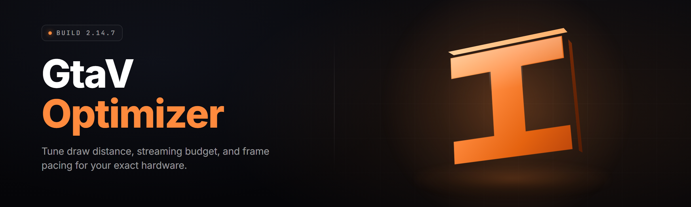

  
  
  

  

  
  
  

---

**GtaV-Optimizer (2026)** — a standalone Windows optimizer built specifically for GTA V / GTA Online: FPS tuning, draw-distance presets, script-hook control, network smoothing, and a full in-game overlay module stack.

---

## 🎯 Comparison — Aspect | Alternative | This Tool

| Aspect | Generic "PC Optimizer" | **GtaV-Optimizer** |
|---|---|---|
| Target audience | Everyone | GTA V / GTA Online players only |
| FPS tuning logic | Blanket registry tweaks | Per-`settings.xml` + RAGE engine tuning |
| Draw distance / LOD control | Not aware of the game | Direct cvar-style preset switching |
| Overlay | None or generic | In-game overlay with live FPS / latency / ped count |
| Script hook management | N/A | Built-in ASI / .dll load-order manager |
| Network smoothing | OS-level only | GTA Online netcode-aware smoothing presets |
| Revert / restore | Manual | One-click snapshot restore before every change |
| Install footprint | Service + driver + autostart | Single portable `.exe`, no install |

The point is simple: a "gaming optimizer" that doesn't know what GTA V actually is will always be worse than a tool that sits inside the game's own config and pipeline. GtaV-Optimizer was built around that single observation.

---

## 📖 What is GtaV-Optimizer — Term | Explanation

| Term | Explanation |
|---|---|
| **RAGE profile** | The GTA V engine profile GtaV-Optimizer switches between (Stability / Balanced / Performance / Competitive) — each maps to concrete cvars and `settings.xml` values. |
| **ASI manager** | Load-order control for `.asi` plugins in the game folder; GtaV-Optimizer reads and re-orders the list without touching the file names. |
| **Netcode smoothing** | GTA Online-specific latency/lerp presets that reduce visible "rubber-banding" during high-ped-count sessions. |
| **Snapshot** | A restore point captured before any change — config, registry, load order, and shader cache in one archive. |
| **Draw-budget** | A bounded preset system that trades distant-LOD quality for FPS without editing individual sliders. |
| **Overlay module** | Any of the in-game HUD panels (FPS / netgraph / ped heat-map / script-hook status) rendered on top of the game. |
| **Clean-run mode** | A start-up mode that disables third-party ASI plugins and overlay injection before the game launches — useful for isolating a crash. |

**Benefits in one pass:**

- 🎮 Tuning that maps to the game's own config instead of generic OS tweaks
- 🧩 Modular overlay — enable only the panels you actually read
- 📦 Portable `.exe` — no installer, no background service, no autostart
- ↩️ Every change is snapshotted and revertable in a single click
- 🧪 Clean-run mode for isolating crashes without uninstalling mods
- 🔒 Profile presets benchmarked across Story Mode and GTA Online separately

---

## ⚙️ Quick Start — numbered steps with emoji markers

1. 📥 Download the standalone `.exe` from the download section below. No installer, no dependencies.
2. 📂 **Extract to its own folder** (e.g. `Desktop\GtaV-Optimizer\`) — do not run it from inside a `.zip`.
3. 🖱️ **Right-click → Run as administrator.** GTA V writes to `Documents\Rockstar Games\GTA V\` and GtaV-Optimizer needs write access there to patch `settings.xml`.
4. 🎛️ Pick a **RAGE profile** (Stability → Balanced → Performance → Competitive) and press *Apply*. A snapshot is taken automatically before the first change.
5. 🚀 **Launch GTA V normally** (Steam / Rockstar / Epic). The overlay injects once the game window has focus.

> If this is your first run: use **Balanced**. It's the profile that has been validated across the fewest incompatible configs.

  

---

## 🗂️ Grouped Module Catalog

GtaV-Optimizer ships 29 modules across six categories. Each category mixes a short prose explanation with the bullet list of individual modules so you can find what you actually need instead of scrolling a wall of checkboxes.

### 🎯 **Performance & FPS Modules**

The performance stack is the reason most users install GtaV-Optimizer in the first place. It works at three layers: the game's own `settings.xml`, the RAGE cvars exposed at runtime, and the OS-side scheduler. Changes at each layer are independent — you can keep the FPS work and skip everything else.

- **Frame-Pacing Tuner** — reads the active monitor refresh and writes a matching frame-limiter target. Prevents GTA V's own variable-limit from fighting V-Sync.
- **Draw-Budget Presets** — four bounded presets (Ultra / High / Perf / Stream) that trade distant-LOD quality for FPS in a single click.
- **Shadow-Scale Normalizer** — sets the shadow scale to a value that's actually visible at 1080p / 1440p / 4K instead of the engine default.
- **Population Density Cap** — separate limits for cars / pedestrians / parked vehicles so you can keep the city busy but kill the density spikes that cost frames.
- **Shader Cache Rebuilder** — wipes and rebuilds `shaders_cache` so the game doesn't recompile mid-session after a driver update.
- **Motion-Blur & DOF Toggle** — a clean off-switch that skips the post-process pass entirely if you don't want it.

### 🌐 **GTA Online — Netcode & Session Modules**

Online is a different workload from Story Mode. The netcode smoothing presets and session tools below are the ones designed specifically for `GTA Online` — everything here defaults to Story-Mode-off so a casual single-player session isn't affected.

- **Net-Smoothing Presets** — five levels of lerp/lerp-speed adjustment tuned against high-ped sessions.
- **Session-Latency Probe** — a lightweight echo latency probe against the Rockstar relay, displayed on the overlay netgraph.
- **Solo-Session Helper** — a small module that helps isolate a session when you want a clean netcode reading — useful for benchmarking, not for griefing.
- **NAT-Type Reporter** — surface the current NAT type so you can sanity-check why matchmaking is struggling.
- **Packet-Loss Overlay** — rolling 60-second packet loss summary drawn in the corner of the overlay.
- **Party-Merge Guard** — an optional guard that blocks accidental merge-into-public transitions when you started a private session.

> The netcode modules do not modify the game's networking code. They read public state and adjust how your client presents it.

### 🧩 **Script-Hook & ASI Modules**

The ASI manager is what keeps the game stable when you have ten plugins fighting each other. GtaV-Optimizer doesn't ship any plugins itself — it *manages* yours.

- **ASI Load-Order Manager** — reorder `.asi` plugins by dependency, version, or manual drag.
- **Plugin Version Inspector** — reads each plugin's embedded version and flags known-conflicting pairs.
- **Safe-Boot Loader** — starts the game with only the plugins you've marked "safe" — everything else waits.
- **Crash-Isolation Mode** — bisects your plugin list across launches to find the one that crashes.
- **Script-Hook Version Check** — verifies your ScriptHookV build matches the game build before launch, not after the crash.

### 🎛️ **Overlay & HUD Modules**

Every overlay panel is optional. There are seven, and yes — you can run all of them at once, but you won't want to.

- **FPS / Frametime Graph** — 1% and 0.1% lows included, because averages lie.
- **Netgraph** — latency, jitter, and packet loss on a single line.
- **Ped / Vehicle Heat-Map** — density counters rendered as a small bar, useful when you're tuning density caps.
- **Script-Hook Status** — shows which ASI plugins are actually loaded as opposed to just present in the folder.
- **Shader-Compile Counter** — tracks how many shader compiles happen mid-session (high numbers mean your driver or cache needs attention).
- **Benchmark Recorder** — press a hotkey, get a 60-second capture exported as CSV.
- **Quiet Mode** — collapses every panel into a single tiny corner readout.

### 🛠️ **Config & Snapshot Modules**

- **Snapshot Manager** — every apply action produces a snapshot before the change. Restore is one click.
- **Settings.xml Parser** — shows what's actually in `settings.xml` in human-readable form instead of raw XML.
- **Config Diff Viewer** — side-by-side diff between two snapshots.
- **Portable Profile Export** — export a full config bundle as a single file you can carry to another machine.

### 🔒 **Guard & Restore Modules**

- **Anti-Regression Guard** — flags when a game update silently resets your tuned values.
- **Launcher-Aware Detection** — knows Steam vs Rockstar vs Epic, and applies config paths accordingly.
- **Driver-Downgrade Warning** — flags GPU driver versions known to misbehave with GTA V's shader cache.

---

## 🖥️ System Requirements — Component | Minimum | Recommended

| Component | Minimum | Recommended |
|---|---|---|
| OS | Windows 10 21H2 (64-bit) | Windows 11 22H2 or newer |
| CPU | 4 threads (Ryzen 3 / i3-8100 class) | 8 threads (Ryzen 5 / i5-12400 class or better) |
| RAM | 8 GB (game + overlay headroom) | 16 GB |
| GPU | Any DirectX 11 card that runs GTA V | Same GPU as the game — overlay has no separate GPU requirement |
| Storage | 60 MB for `.exe` + snapshots | 500 MB if you keep long snapshot history |
| Permissions | Administrator on first run | Administrator if you use the ASI manager |
| Runtime | .NET Framework 4.8 (already on Win10/11) | Same — no extra runtime |
| Game | GTA V Legacy build on Steam / Rockstar / Epic | Same — Enhanced build supported from the 2026 update |

---

## 🧮 Key Features — Feature | Description | Benefit

| Feature | Description | Benefit |
|---|---|---|
| RAGE Profile switching | Slider-free preset system mapped to engine cvars | Change tuning level without knowing any cvar names |
| Draw-Budget presets | Bounded quality presets that trade draw distance for FPS | Predictable FPS gains without manual slider trial-and-error |
| Netcode smoothing presets | Online-specific lerp and jitter adjustments | Fewer visible skips during dense online sessions |
| ASI load-order manager | Full reorder control for `.asi` / `.dll` plugins | Diagnose plugin conflicts without deleting files |
| Crash isolation | Bisect plugin list across launches | Find the crashing plugin instead of guessing |
| Snapshot + restore | Auto-snapshot before each change, one-click revert | Zero-risk tuning — you can always go back |
| Seven overlay panels | FPS / netgraph / heat-map / hook-status / shader counter / benchmark / quiet | Only pay the overlay cost for what you read |
| Config diff viewer | Side-by-side snapshot comparison | See exactly what changed between two working configs |
| Clean-run mode | Launch without third-party load | Isolate "is it the game or is it my mods" in one click |
| Launcher-aware paths | Detects Steam / Rockstar / Epic install paths | No "where is your GTA folder" prompt on first run |
| Anti-regression guard | Flags when a game update resets tuned values | Your 240 FPS profile doesn't silently revert after a patch |
| Portable profile export | Configuration bundle as a single portable file | Move a known-good tuning to another PC in one drag |

---

## 💡 Tips for best results

- Apply a snapshot **before** you start tweaking — GtaV-Optimizer does this automatically on the first apply, but the manual snapshot button exists for a reason.
- Change **one profile dimension at a time** on your first day. Do the FPS pass first, confirm stability, then add netcode, then overlays.
- If you're on a laptop: run GtaV-Optimizer on the *same* power plan you'll actually play on. Profile swapping on battery will give you false readings.
- The overlay costs frames. If you're chasing single-digit-percent gains, put it in **Quiet Mode** or disable it entirely.
- Rebuild the shader cache after **every** GPU driver update. The Shader Cache Rebuilder module exists because this is the number one cause of mid-session stutter.
- If a fresh GTA V update lands, wait for GtaV-Optimizer to flag the anti-regression guard before applying anything — patches move config paths.
- Keep one snapshot labeled "stock" that you never touch. It's your escape hatch.

---

## ❓ FAQ

<strong>Is GtaV-Optimizer a mod, a trainer, or an optimizer?</strong>

It's an optimizer. It doesn't inject cheats, doesn't grant items, and doesn't touch player state. It works on the game's config files, cvars, and plugin load order — the same surface your own `settings.xml` occupies.

<strong>Does it work with GTA Online?</strong>

Yes — the Online-specific modules (netcode smoothing, latency probe, party-merge guard) are explicitly built for it. Story-Mode-only modules are off by default in Online sessions. Note that modding GTA Online is against Rockstar's terms; if you use ASI plugins, do it in a private or solo context and accept the risk yourself.

<strong>Will GtaV-Optimizer get me banned?</strong>

The optimizer itself doesn't behave like a cheat — it doesn't read or write game memory, and it doesn't inject into the game process for anything except the overlay. But it does manage ASI plugins, and some ASI plugins will get you banned on GTA Online. You are responsible for what you load. Our default LoadList is empty.

<strong>Does it need to be running while I play?</strong>

Only if you want the overlay. All profile changes are written to the game's config on disk. If you don't need live FPS/netgraph panels you can close the optimizer once you've applied a profile.

<strong>Can I run it alongside MSI Afterburner / RivaTuner / ReShade?</strong>

Yes, but not always *all at once*. RTSS and GtaV-Optimizer's overlay both hook present() — pick one for the FPS panel. ReShade's shader chain is compatible as long as you don't also use the shader-cache rebuilder in the same session.

**Q:** Is this open source?

**A:** The optimizer builds are distributed as a standalone `.exe`. The repository hosts docs, issue tracking, snapshot manifests, and the community bug-reproduction templates — the binary is the product.

**Q:** What's the license?

**A:** MIT for the repo contents. The `.exe` build ships with a bundled license file that mirrors it.

**Q:** Do snapshots take up a lot of disk?

**A:** A single snapshot is typically under 4 MB unless you keep shader caches in it. If you're tight on disk, disable shader-cache inclusion in snapshot settings.

**Q:** Can I share a profile with a friend?

**A:** Yes — Profile Export writes everything except machine-specific paths. Import reads it back and re-resolves the game folder relative to the receiving machine.

---

## 🧨 The Problem — niche pain-point bullets

- **Generic optimizers don't know GTA V exists.** They set Windows visual-effects to "best performance" and call it a day. The actual FPS bottleneck in GTA V lives in `settings.xml` and RAGE cvars they never touch.
- **Draw-distance tuning is trial-and-error hell.** Six related sliders, no clear units, and a fog system that doesn't behave linearly. Most players settle for one of two extremes and lose either the city or the framerate.
- **Online session quality is invisible.** You can't see jitter, packet loss, or the actual lerp state without a netgraph — so you can't tune it.
- **Ten ASI plugins is a snowballing crash lottery.** No standard load-order, no version inspection, no isolation mode. Removing plugins one-by-one is the community's only diagnostic.
- **Game updates silently revert everything.** Rockstar patch → your tuned `settings.xml` → replaced with engine defaults → you retune from scratch.
- **No undo.** Every manual change to the game folder is potentially permanent unless you backed something up, which nobody does.
- **Laptop users get misled constantly.** A profile that "improves FPS" on AC never shows up because the power plan and thermal throttling dominate the numbers.

---

## ✅ The Solution — Problem | Solution

| Problem | Solution |
|---|---|
| Generic optimizers ignore GTA V internals | GtaV-Optimizer talks directly to `settings.xml` and RAGE cvars |
| Draw-distance trial-and-error | Bounded Draw-Budget presets replace six sliders with four named levels |
| Invisible online session quality | Netgraph + latency probe + packet-loss overlay in one panel |
| Plugin crash lottery | ASI load-order manager with version inspection and bisect-based crash isolation |
| Patch reverts tuned configs | Anti-regression guard flags when a patch has clobbered tuned values |
| No undo | Automatic snapshot before every apply; one-click restore |
| Laptop tuning mismatch | Overlay records under real play conditions, not a desktop test bench |

---

## 🧷 Overview — Category | Details

| Category | Details |
|---|---|
| **Name** | GtaV-Optimizer |
| **Year** | 2026 |
| **Type** | Windows `.exe` — standalone, portable, no installer |
| **Target** | GTA V (Legacy and Enhanced), Story Mode and GTA Online |
| **Module count** | 29 across 6 categories |
| **Overlay panels** | 7 (all optional) |
| **Config surface** | `settings.xml`, RAGE cvars, ASI load order, shader cache, OS scheduler |
| **Revert model** | Snapshot-before-change, one-click restore |
| **Distribution** | Standalone `.exe` — download, extract, run |
| **Language** | English UI |

GtaV-Optimizer exists because the "PC optimizer" category has never spent a single release cycle on an actual game's tuning surface. The project's assumption is simple: if you're going to change settings for a game, change the ones the game reads.

---

## 🧰 Installation — numbered sub-steps

1. **Download the `.exe`.**
   Use the download button below. You'll get a single portable Windows executable — no installer, no MSI, no registry hooks during distribution.

2. **Extract to its own folder.**
   Windows SmartScreen will flag unsigned builds by default. If you trust the source (this repo), right-click the file → Properties → Unblock before running.

3. **Run as administrator the first time.**
   The optimizer needs to read and write `Documents\Rockstar Games\GTA V\` and (optionally) the game's ASI folder. After the first run, the config paths are cached and admin is only required again when you change the game install.

4. **Pick your launcher and profile, then apply.**
   The first-run wizard asks which launcher owns your GTA V install, then asks which RAGE profile you want. Balanced is the safe default. A "stock" snapshot is captured automatically.

5. **Launch the game and let the overlay confirm.**
   Once the game window has focus, the overlay shows a small FPS readout in the corner. If you see it, the optimizer is active. If you don't, the game probably launched before the overlay hook was ready — restart the game.

---

## 📊 All Modules Status — Module | Status | Description

| Module | Status | Description |
|---|---|---|
| Frame-Pacing Tuner | ✅ Working | Matches game limiter to monitor refresh |
| Draw-Budget Presets | ✅ Working | Four bounded draw-distance levels |
| Shadow-Scale Normalizer | ✅ Working | Picks resolution-appropriate shadow scale |
| Population Density Cap | ✅ Working | Independent car / ped / parked caps |
| Shader Cache Rebuilder | ✅ Working | Wipes and rebuilds `shaders_cache` |
| Motion-Blur & DOF Toggle | ✅ Working | Skips the post-process pass |
| Net-Smoothing Presets | ✅ Working | Five online-specific smoothing levels |
| Session-Latency Probe | ✅ Working | Echo latency against relay |
| Solo-Session Helper | ✅ Working | Isolate a session for clean readings |
| NAT-Type Reporter | ✅ Working | Surfaces current NAT type |
| Packet-Loss Overlay | ✅ Working | 60-second rolling packet-loss summary |
| Party-Merge Guard | ✅ Working | Blocks accidental private → public merge |
| ASI Load-Order Manager | ✅ Working | Reorders `.asi` / `.dll` plugins |
| Plugin Version Inspector | ✅ Working | Reads embedded plugin versions |
| Safe-Boot Loader | ✅ Working | Starts only marked "safe" plugins |
| Crash-Isolation Mode | ✅ Working | Bisects plugin list to find crashes |
| Script-Hook Version Check | ✅ Working | Verifies SHV build matching |
| FPS / Frametime Graph | ✅ Working | Includes 1% and 0.1% lows |
| Netgraph Panel | ✅ Working | Latency / jitter / loss on one line |
| Ped / Vehicle Heat-Map | ✅ Working | Density counters for tuning |
| Script-Hook Status Panel | ✅ Working | Reflects actual loaded state |
| Shader-Compile Counter | ✅ Working | Tracks mid-session shader compiles |
| Benchmark Recorder | ✅ Working | 60-second CSV capture |
| Quiet Mode | ✅ Working | Collapses all panels to one small readout |
| Snapshot Manager | ✅ Working | Per-change snapshots, one-click restore |
| Settings.xml Parser | ✅ Working | Human-readable config view |
| Config Diff Viewer | ✅ Working | Side-by-side snapshot diff |
| Portable Profile Export | ✅ Working | Single-file profile bundle |
| Anti-Regression Guard | ✅ Working | Flags values reset by game patch |

---

## 🚧 Known Issues — Issue | Fix

| Issue | Fix |
|---|---|
| Overlay doesn't appear on first launch | Launch the game after the optimizer (not before). The hook needs the optimizer process alive when the game window is created. |
| FPS panel fights with RTSS | Disable RTSS's on-screen display for GTA V — two present() hooks on the same process will stutter. |
| Settings.xml says "locked" | GTA V or Rockstar Launcher is holding the file. Fully exit both, then apply. |
| Crash-Isolation doesn't converge | One of your plugins is loading lazily (its `.asi` loads a second `.dll` at runtime). Mark suspected bundles as single units in the load-order manager. |
| Snapshot restore after a game update loses overlay settings | Expected on `.exe`-side changes only if the optimizer was reinstalled. Export a profile before install changes. |
| Netgraph shows constant jitter on Wi-Fi | It's Wi-Fi. The netgraph is showing you the truth. Use Ethernet for any tuning conclusions. |

**Troubleshooting flow:**

1. Game crashes after apply → restore last snapshot → verify game boots clean → reapply one profile dimension at a time.
2. Game boots but overlay missing → confirm optimizer is running → confirm game was launched after optimizer → check NAT/AV isn't blocking `present` hook.
3. FPS worse after apply → open Config Diff → revert the last changed line group → re-benchmark.
4. Online unstable → switch to netcode preset 2 (default) → drop to preset 1 if you're on Wi-Fi.
5. Game update landed → wait for anti-regression guard prompt → snapshot → reapply profiles.

---

## 🧭 Compatibility / platform support

| Platform | Support |
|---|---|
| Windows 11 22H2+ | Full |
| Windows 10 21H2+ | Full |
| Windows 8.1 | Not supported (overlay hook requires DXGI present paths that are unstable there) |
| Windows 7 | Not supported |
| Steam version of GTA V | Full — auto-detected |
| Rockstar Launcher version | Full — auto-detected |
| Epic Games version | Full — auto-detected |
| GTA V Legacy build | Full |
| GTA V Enhanced build (2026) | Full |
| Linux via Proton | Untested — overlay hook likely won't initialize |
| macOS | Not supported |

---

## ⬇️ Download

The build has no fixed filename — you'll receive a self-contained Windows `.exe`. Extract it, right-click → Run as administrator, and pick a RAGE profile. If it's your first time, use Balanced.

  

---

GtaV-Optimizer is maintained as a hobbyist / educational project for the GTA V modding community. It's not affiliated with Rockstar Games or Take-Two. Use it at your own risk — especially online, where the community's terms-of-service line is well-known and enforced. Snapshot before you change anything, and if you're going to push the tool into territory it wasn't designed for, do it in Story Mode first.
